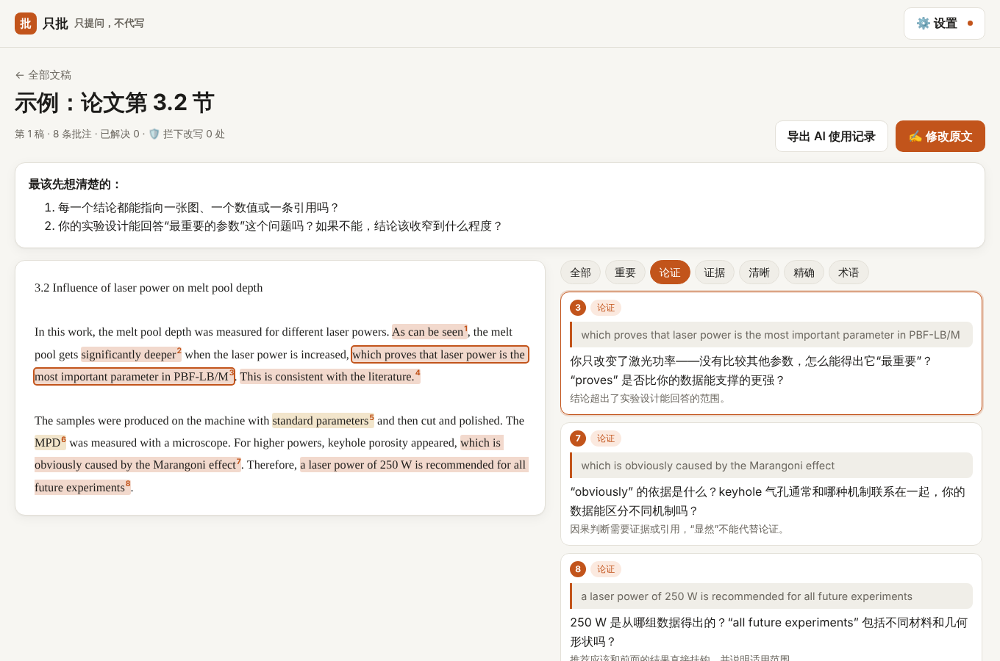

# 只批 · 只提问，不代写的写作反馈

> AI 只在你的原文上**批注和提问**，指出哪里站不住、读者会卡在哪，**绝不给出改写后的句子**。这一点由程序强制保证。你改完之后，它**逐条核对**问题有没有真正解决，并生成一份 **AI 使用记录**，可以附在你的 Eigenständigkeitserklärung 里。



## 为什么做这个

市面上的 AI 写作工具（Grammarly、Paperpal、Writefull 等）大多直接帮你改写：文字变好看了，但写作能力没长进；在学位论文里，还可能违反学校关于 AI 使用的规定。学界确实有“只提问、不改写”的思路，例如研究原型 Scraft 和 Critical Inker，以及大学写作中心给出的 prompt 建议。但它们都只靠 prompt 约束模型，模型偶尔还是会“顺手”给出一句改写。商业产品里 Packback 最接近，可它也会插入 AI 的建议。

只批的改进：

| | 常见做法 | 只批 |
|---|---|---|
| 不代写 | 写在 prompt 里，靠模型自觉 | prompt 要求 **加上程序护栏**（`src/lib/guard.ts`）：引号里出现原文没有的新措辞，或者“改为…”“rewrite as…”“ersetzen durch…”之类的改写，都会在显示前被移除并计数 |
| 批注位置 | 泛泛而谈 | 每条批注都**锚定原文中的一段话**（逐字匹配，找不到时做模糊匹配），点高亮就能看到对应问题；找不到出处的批注会被丢弃 |
| 修改之后 | 再从头评一遍 | **逐条复查**：每个问题是已解决、部分解决还是未解决；修改中新引入的严重问题会单独列出 |
| 学术诚信 | 没有记录 | 导出 **AI 使用记录**（中德双语）：每次审阅的时间、模型、批注数、拦下的改写数 |

## 真实模型测试

`npm run eval` 用应用里**完全相同的提示词、护栏和锚定代码**，通过 Claude Code CLI 调用真实的 Claude（`claude-opus-5-5`）。测试材料是 3 份我写的草稿：英文论文段落、德文实验报告、中文课程短文，每份都**故意植入 5 个已知问题**，比如没有统计检验的 “significantly”、没定义的缩写、没有引用的 “Previous studies”、因果跳跃、用断言代替论证。英文稿再做一轮复查测试：改掉其中 2 个问题，留下 3 个。

| 轮次 | 通过 | 发现与改动 |
|---|---|---|
| [第一轮](eval/results/1-baseline/report.md) | 16/17 | 15 个植入问题全部找到；显示给用户的内容里没有改写。但护栏在模型**没有改写**的情况下仍移除了 4+4 处：英文稿收到中文反馈，引号里是对英文原文的中文转述（这一点在浏览器测试里也发现了）；中文稿里则是对原文的简短转述 |
| [第二轮](eval/results/2-paraphrase-fix/report.md) | 15/17 | 修复跨文字的情况：引号里的文字和原文不是同一种文字时，不可能被直接贴进原文。另外允许“近似引用”：引号里的片段有 ≥ 75% 的二元组出现在原文中，就算引用原文。中文稿里的简短转述（“成绩下降”“应禁止”）仍被误删 5 处 |
| [第三轮](eval/results/3-own-words-labels/report.md) | **19/20** | 新增：≤ 12 个汉字（或 ≤ 4 个词）、且几乎全部由原文用字组成的短标签不算改写。**误删降到 0–1 处**；真实的改写（例如“该方法将精度提高了 12%”）仍会被移除。新增了“护栏不误删”这一项检查 |

第三轮的结果：

- 15/15 个植入问题都被指出。
- 33/33 条批注锚定成功。
- 3 份草稿里**都没有任何改写到达用户**。
- 复查时，改掉的 2 个问题都判为“已解决”或“部分解决”，留下的 3 个问题里有 2 个判为“未解决”。

**没通过的一项**：没改动的缩写 “SR”，其中一条相关批注被判成“部分解决”而不是“未解决”。

**护栏的取舍**：它刻意偏严格。像“AI 会出错”这种改动较大的转述，仍可能被当成新措辞移除；我们宁可偶尔多删一句提问，也不让一句代写漏过去。

## 快速开始

```bash
npm install
npm run dev
```

先点「看示例：论文一节的批注」，不需要 API Key。要批注自己的稿子，在「设置」里填入 [Anthropic API Key](https://console.anthropic.com/settings/keys)。Key 只保存在浏览器里，请求从浏览器直接发给 Anthropic。PDF 在本地用 pdf.js 转成文字，不上传原文件。

## 代码结构

```
src/lib/guard.ts     不改写护栏 + 原文锚定（应用和 eval 共用）
src/lib/prompts.ts   审阅、复查的提示词和 schema
src/lib/engine.ts    护栏/锚定的后处理、复查、AI 使用记录
src/components/DocView.tsx  原文高亮 + 批注列表 + 修改与复查
eval/run.ts          真实模型测试
```
